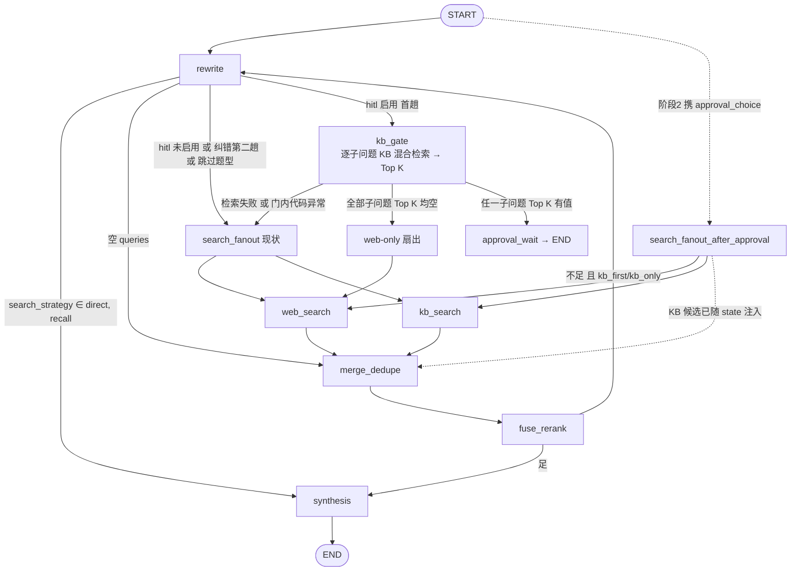
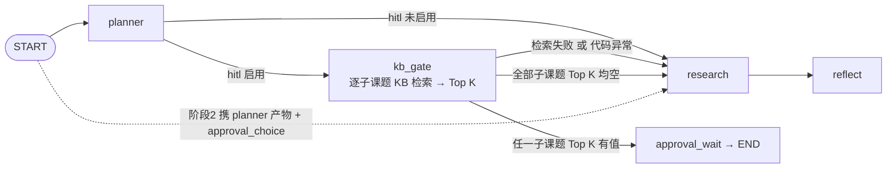
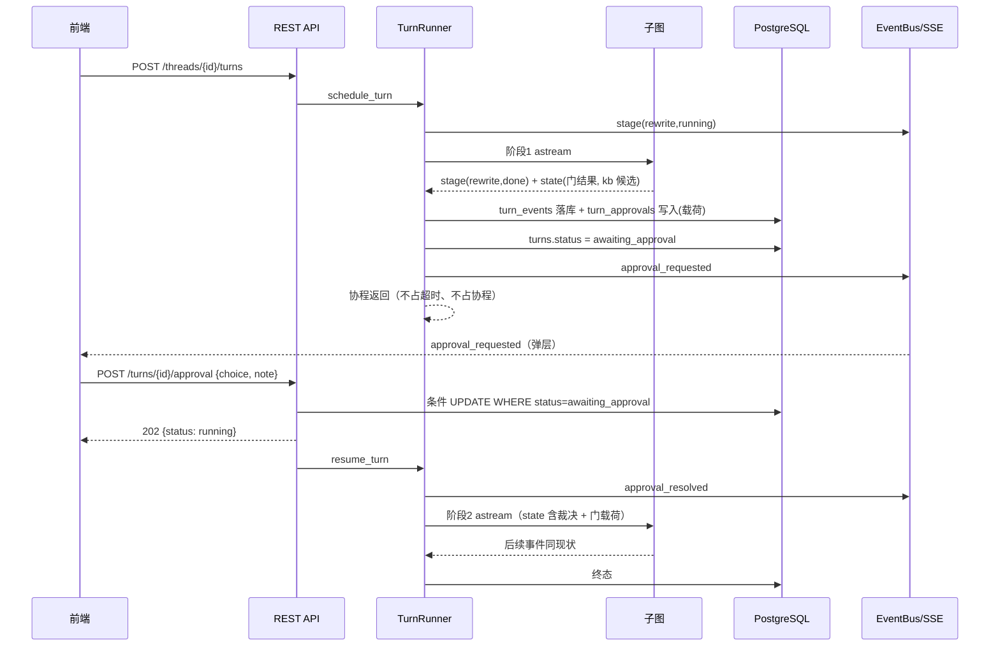
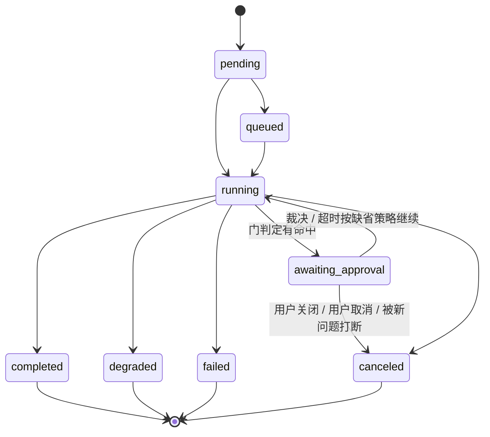
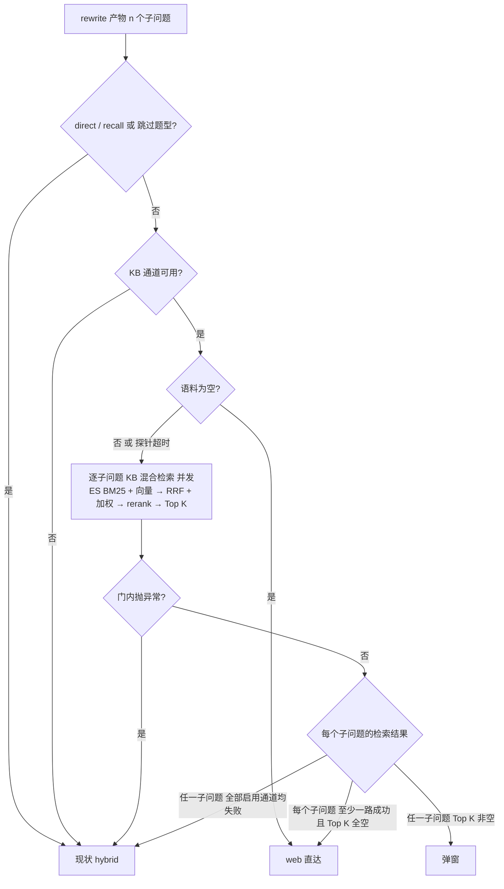
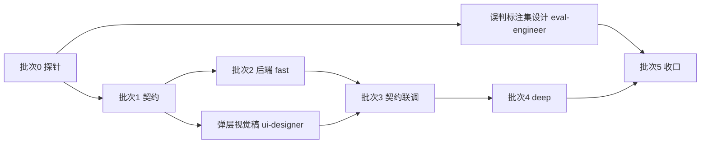

# 方案：KB 语料条件化 HITL 审批门（工单建议号 B22）

- 状态：**方案草案，待用户裁决**（零代码改动、零契约文档改动；本文所有「建议值」均未生效）
- 日期：2026-11-26
- 已裁决项（同日两次）：
  1. **OQ-B**：判定「知识库无可支撑片段」→ 直接走 web，不弹窗。
  2. **判定器确定性化**：删除 LLM 分类层，零 LLM 调用。「只要 Top K 有值就算相关（就弹窗）」，歧义由用户看弹窗预览判断。
- 输入：用户原始需求（2026-11-26 转述）+ 主会话架构研判七条 + 用户裁决两次
- 路径简写：`app/` = `apps/search-api/app/`，`fe/` = `frontend/src/`

**证据口径**：凡标 `文件:行` 的均为本次实际读过；标「未读」的是我没打开、结论需实施前复核的点。成本/性能数字凡未标注来源的都是**待测量的估算**，不是实测值。

---

## 0. 结论先行

1. **主会话研判有一处需要纠正：当前工程不能直接用 LangGraph `interrupt()`/`Command(resume=…)`。** 三张图都是无 checkpointer 编译（`app/agent/graphs/fast.py:91`、`deep.py:97`、`main.py:143` 均为裸 `builder.compile()`），而 `asyncio.timeout` 包住整个 astream（`app/services/turn_service.py:2635`）。建议改用**「两阶段执行」**：阶段 1 跑到审批门自然结束并落库 → 释放协程 → 用户裁决后用持久化载荷重新发起阶段 2。详见 §3.1（hitl-OQ-01，本方案最大的裁决点）。
2. **fast 插入点成立**：`rewrite` 条件边（`fast.py:84`）与现有 direct/recall 判定（`app/agent/nodes/web_search.py:70-71`）之后、Send 扇出之前，子图内扩展、主图零改动。
3. **deep 插入点字面成立但语义不同**：`planner → research` 是普通边（`deep.py:85`），deep 没有 rewrite 节点；deep 的 KB 是子代理**工具**（`app/agent/nodes/deep_research.py:551-553`）而非图节点，所以 deep 的「仅 KB/仅网络」只能靠工具面约束，不能靠 Send 形态。建议 fast 先行、deep 作为第二批独立灰度键。
4. **新 turn 状态 `awaiting_approval` 要动的既有面比预想多**：取消端点（当前靠取消标志被运行中的协程 pop，`turn_service.py:1025-1067` + `2692`，awaiting 态没有消费者）、启动孤儿清理（`turn_service.py:2239` 注）、前端生成中集合（`fe/stores/turn.ts:210-216`）、SSE 具名事件注册（`fe/sse/turnStream.ts:348`）。
5. **判定器是纯确定性的：门自身零 LLM 调用。** 判定树只有三叉：全部子问题 Top K 严格为空 → web 直达；任一子问题 Top K 有值 → 弹窗；检索失败 → 回落现状 hybrid。分数只用于预览排序，不设拦截阈值。
6. **这个简化把误判的风险重心整个挪到了「误弹窗」一侧。** 没有 LLM 判无，所以「真相关却判无」只剩检索召回失败一种成因（概率最低的一类）；代价是任何一条 rerank 残渣都会触发弹窗。兜底是用户看预览一眼选「仅网络」——绝不静默，但会打扰。因此弹窗率是 shadow 期唯一要盯的数，必要时用「噪声地板」阈值收敛（hitl-OQ-17）。
7. **成本收益不是白拿的**：只有用户真选「仅知识库」的轮才省下 web 腿。门自身的成本是「KB 检索由并行变先行」的延迟，没有判定调用成本。净收益公式与待测项见 §1.2。

---

## 1. 背景与目标

### 1.1 目标

在检索发生前先用近零本地成本的 KB 探测回答一个问题：「知识库里有没有相关片段？」

- 任一子问题有命中 → 弹窗，由用户看预览决定是否只靠知识库
- 全部子问题严格零命中 → **不弹窗，直接走 web 检索，KB 结果不进融合**（用户裁决 2026-11-26）

子目标：

- G1：KB 可独立回答的轮不调用 web 搜索 MCP（省付费额度 + 省下游上下文 token）
- G2：是否用 KB 的决定权交给当轮用户，而不是全局静态路由（`app/agent/nodes/kb_route.py:59-69`）
- G3：开关关闭时**逐字节等于现状**（灰度纪律）
- G4：门的判定与用户裁决都可回看、可审计

### 1.2 成本动机的量化框架

**web 腿省下的是什么（C_web）**

| 组成 | 量级依据 | 说明 |
|---|---|---|
| 搜索 MCP 调用的配额 | Tavily 付费额度（AGENTS.md 记有「.env.test 键 432 额度耗尽」，说明额度是真约束）；SearXNG 自托管货币成本近零 | 这是**真实的货币/配额节省** |
| 下游上下文 token | web 候选每 query 每源 top_k=5（`web_search.py:50`）→ 融合截取后 snippet ≤500 字符进 rerank 与 synthesis（`fast.py:17`） | rerank 调用 + synthesis prompt 都会少喂一批 web 片段 |
| synthesis 输出 token | 不变 | 不省 |
| deep 侧 | AGENTS.md：M2 抽样 37 轮 1,041,516 tokens ≈ 28k/轮，主要在 research 段 | deep 的节省空间远大于 fast，但风险也最高 |

OQ-B 的 web 直达轮**不省 web 腿**；它省的是 KB 候选在融合/rerank/synthesis 里的那点上下文，收益很小。它的真正价值在答案质量（不拿无关片段稀释供给面），不在成本。

**gate 自身的成本（C_gate）**

| 组成 | 量级 | 说明 |
|---|---|---|
| LLM 调用 | **0** | 判定器确定性化（用户裁决） |
| KB 检索 | 货币边际 ≈ 0 | 检索量与现状 hybrid 相同（现状也是逐 query 发 kb_search Send，`web_search.py:94-106`）；变的只是次序 |
| rerank 调用 | 需确认 | 门的 Top K 定义在 rerank 之后（用户裁决口径）。现状 KB rerank 发生在图级 `fuse_rerank`（`fast.py:17`）；若门内要先出 Top K，rerank 会前移，**是否因此多调一次需实施前核实**（见文末清单） |
| 串行延迟 | KB 检索各子问题并发，包络仍为 3s（`app/agent/nodes/kb_search.py:104`） | 现状是 web‖kb 并行；改后是 KB → 分流 → web 串行，多付的是一轮 KB 检索的墙钟时间 |
| 人工时间 | 弹窗轮的用户阅读与选择 | 不进成本口径，但是这个功能最大的体验代价 |

**净收益（每轮期望）**

```
净节省 = P(弹窗) × P(选「仅知识库」| 弹窗) × C_web − 延迟代价
```

两个推论，直接决定设计：

- 用户选「两者都要」或「仅网络」的弹窗是**纯开销**（没省 web，还多一次打断）。「Top K 有值就弹」的口径会主动制造这类开销——这是用户裁决下有意的取舍（用打扰换「绝不漏掉 KB」），不是疏漏。
- 延迟预算有富余：fast P50=15.43s / 30s（AGENTS.md 批次 9 复测），多付一轮 KB 检索（≤3s）可承受，但需在批次 0 实测确认。

**必须在批次 0 测出来的基线（我现在没有数据）**：每轮 web 候选条数与进 synthesis 的 web snippet token 数、Tavily 每轮平均消耗 credits、弹窗率与零命中率、门段墙钟延迟（KB 检索 + rerank）P50/P95。

---

## 2. 现状点位映射

### 2.1 图编排

| 点位 | 现状 | 证据 |
|---|---|---|
| 主图壳 | START → `safety_check` → `route_by_mode` 条件边 → 子图节点；无 checkpointer | `app/agent/graphs/main.py:127-143` |
| 注册表 | `GRAPH_REGISTRY = {fast, deep}`，扩展原则=子图内扩展、主图拓扑零改动 | `app/agent/graphs/registry.py:26-34` |
| fast 拓扑 | START→rewrite；rewrite 条件边 `search_fanout` 目标表 `["web_search","merge_dedupe","synthesis","kb_search"]`；WS→MG←KS；MG→fuse_rerank→条件边（synthesis｜rewrite 纠错回边） | `fast.py:50`、`:74-91` |
| rewrite 出边判定序 | ① direct/recall → synthesis；② 空 queries → merge_dedupe；③ `resolve_kb_route`：hybrid=web+kb 双 Send，kb_first/kb_only=仅 kb Send | `web_search.py:53-109` |
| deep 拓扑 | START→planner→research→reflect⇄supplement→guards→writer｜degraded_writer | `deep.py:75-97` |
| deep 的 KB | 子代理工具 `kb_search`，docstring 限定「仅当问题指向用户私有文档时使用」；通道未启用时返回系统注 | `deep_research.py:551-559` |
| search running 帧 | 仅 web_search index-0 副本发；kb_search 不发 running | `web_search.py:127-128`、`kb_search.py:31` |

### 2.2 KB 现状能力

- 语料探针只判「有无」：index-0 副本 `corpus_chunk_count`，1s 独立超时、失败按非空处理（`kb_search.py:52-54`、`:121-135`）。
- `kb_search` 节点每 query 副本做双通道并发检索（各自 3s 包络，`kb_search.py:139-171`），产出的是**通道原始行**（`_candidate_from_row`，`:69-86`，`score` 为通道行分数），写入 `candidates`。**融合（RRF）与 rerank 不在该节点内**：RRF 收口在 merge_dedupe，KB rerank 在 fuse_rerank（`fast.py:15-18`）。
- 因此「逐子问题 Top K（RRF → 加权 → rerank → Top K）」这个粒度**现有节点不直接产出**，需要抽出一个可复用的「单 query 检索到 Top K」函数。`app/rag/retrieval.py` 我没读，里面是否已有这个函数待确认（文末清单）。
- `kb_supply_verdict` 是零 LLM 的确定性 gate，判据里的 top1 是 RRF 分（`kb_route.py:176-180`），只在 kb_first/kb_only + `correction_enabled=true` 时生效（`:141-183`）。
- 三档路由是全局静态：`correction_enabled=false`（缺省）时 kb_first/kb_only 一律降级 hybrid（`kb_route.py:103-106`）。
- `kb_available(spec)` 双通道全关判定已有（`kb_route.py:104` 引用）。

### 2.3 TurnRunner 与状态机

| 点位 | 现状 | 证据 |
|---|---|---|
| 状态常量 | ACTIVE=(pending, running)、QUEUED、FINAL=(completed, degraded, failed, canceled) | `turn_service.py:131-133` |
| 轮级硬超时 | `asyncio.timeout(timeout_s)` 包整个 astream；缺省 fast 120s / deep 600s | `turn_service.py:161`、`:2635` |
| configurable 注入 | cancel_flags 引用、model_mapping、search_chain、read_chain、tools_registry、kb_retriever、usage_collector、turn_deadline | `turn_service.py:2638-2662` |
| 取消机制 | 每个事件边界 pop 取消标志（`:2692`）；节点入口 `ensure_not_canceled` 抛 `TurnCanceledSignal`（`app/agent/guards.py:439-447`、`:380-398`） | — |
| 首 stage 图前发布 | fast=rewrite、deep=plan 的 running 帯由 TurnRunner 发 | `turn_service.py:2615-2617` |
| 并发策略 | `resolve_conflict_on_submit`：reject/enqueue/interrupt/rollback；排队深度 1 | `turn_service.py:954-1020`、`:146` |
| 取消端点 | 终态 409002；queued 立即出队；运行中登记标志 | `turn_service.py:1025-1067` |
| 历史纳入 | completed/degraded/canceled | `turn_service.py:172` |
| regenerate 可进 | degraded/failed | `turn_service.py:138` |

### 2.4 契约现状

- turn 状态枚举 7 值：`pending | running | queued | completed | degraded | failed | canceled`（`docs/contract/api.md:265`；镜像 `fe/types/api.d.ts:135-142`）。
- stage_key 是封闭枚举 `rewrite | search | read | reflect | plan | write | code_exec`（`api.md:797`；`api.d.ts:153-154`）。
- SSE：15s 心跳不占 seq、重放缓冲 TTL 30 分钟、终态轮重放后发合成 done（`api.md:771-773`）。
- 端点总表 42 个（`api.md:715`）。

### 2.5 前端现状

| 点位 | 现状 | 证据 |
|---|---|---|
| 事件派发 | `applyEvent` 单入口 switch；控制事件有 seq 幂等门 | `fe/stores/turn.ts:361-447` |
| 生成中集合 | 只认 running/queued | `turn.ts:210-216` |
| 终态判定 | 四终态 | `turn.ts:65-69` |
| 流式态 | `isStreaming = status === 'running'`，驱动停止钮 | `fe/views/AnswerView.vue:106` |
| 输入区 | `.follow-bar` 固定底部，内含 `SearchCard`，`:streaming` 时提交钮变停止 | `AnswerView.vue:576-601` |
| 弹层先例 | `ThreadModal` Teleport 到 body | `fe/components/threads/ThreadModal.vue:52` |
| SSE 具名帧 | 逐事件名 `addEventListener` 注册，未注册的名字收不到 | `fe/sse/turnStream.ts:340-348` |
| 刷新恢复 | REST 为准源对账；运行中轮 answer_md 为空串则全量重放 | `turn.ts:318-327`、`:694-733` |

**未读、实施前需复核**：`app/rag/retrieval.py`（检索管道与 Top K 产出点）、`fe/components/search/SearchCard.vue`（输入框内部结构）、`app/services/event_bus.py`（重放缓冲与 subscribe 实现）、`data-model.md` 的 turns / turn_events DDL 与落库事件子集、`nacos-config.md` 的 kb 节全文、`app/agent/nodes/fast_rewrite.py`、`app/agent/nodes/fuse_rerank.py` 与 `merge_dedupe.py`、`_translate_custom` 剩余部分（`turn_service.py:2817` 之后只读到 2830）、启动孤儿清理实现体。

---

## 3. 图拓扑与状态机

### 3.1 暂停机制选型（hitl-OQ-01）

| 方案 | 做法 | 成熟度/风险 | 改动面 | 结论 |
|---|---|---|---|---|
| A 原生 interrupt | 给三图加 checkpointer（如 Postgres saver），门节点 `interrupt()`，TurnRunner 消费 `__interrupt__`，裁决后 `Command(resume=…)` | LangGraph 成熟机制，但**本工程从未启用 checkpointer**；`asyncio.timeout` 包整个 astream 需重构为「暂停即停表」；checkpointer 的 thread 级 config 与现有多轮并发/regenerate 语义要对齐；迁移新增 checkpointer 表 | 大，且触及 R14② 未经实证的 interrupt 半边 | 不推荐（至少不是第一批） |
| B 两阶段执行 | 阶段 1 图跑到门节点后经条件边到空操作终结节点自然 END；TurnRunner 落 `awaiting_approval` + 载荷后返回；裁决后用持久化载荷重新 `astream`，入口按 state 条件直达扇出 | 不引入新机制，完全落在现有「图纯函数、持久化归 TurnRunner」的架构上；协程不挂起、重启可恢复、超时天然分段 | 中：TurnRunner 新增一条恢复路径 + 一张表 | **推荐** |
| C 进程内挂起 | 协程内 `asyncio.Event` 等待 | 重启即丢；占协程；与 `asyncio.timeout` 冲突；多实例不可用 | 小 | 否决 |

方案 B 的两个要点：

- **入口**：子图用条件入口（START 条件边）——state 无 `approval_choice` 时走原路径（rewrite/planner）；有且带已落库的门结果时直达检索段。三图仍是 import 即编译一次，`registry.py` 与 `main.py` 零改动。
- **未验证项**：`interrupt()` 在无 checkpointer 下的具体行为我没有在 langgraph==1.2.19 上实测，方案 A 的「不可恢复」判断来自机制原理。建议批次 0 用 20 行探针钉死并留档，作为 ADR 的证据。

### 3.2 fast 拓扑



- `kb_gate` 节点职责：对 rewritten_queries 逐子问题做 KB 混合检索到 Top K（各子问题并发）→ 区分「检索成功/失败」→ 按判定树（§4.1）分流 → 写 state（门结果、KB 候选、预览）。**节点内零 LLM 调用**。
- `approval_wait` 是空操作终结节点，只为让图自然 END。
- **web-only 扇出是图内直达，不经过审批**：全部子问题零命中时，门节点同一次执行内直接产 web Send，图不结束、不落 awaiting。KB 候选不写入 `candidates`。
- `search_fanout_after_approval` 不是新节点，是 `search_fanout` 的一个分支：`approval_choice` 存在时优先于 `resolve_kb_route`。
- **不往 `kb_route` 借语义**：裁决结果放新键 `approval_choice`。`KB_ROUTE_VALUES` 是 rewrite 输出的冻结值域（`kb_route.py:50`），`web_only` 不在其中。`kb_supply_verdict` 读的是 `kb_route`（`kb_route.py:159`），所以用户选 KB-only 后**不会**触发纠错回边——用户裁决即权威，这是想要的行为，且是自然得到的。
- state 新键需进 `MainState` 投影（`app/agent/state.py:43-110`）与 `FastState`，受 R14① 状态契约测试约束。

**分流结果到检索形态的映射（fast）**

| 分流 | 来源 | web Send | KB 候选 | 是否中断图 |
|---|---|---|---|---|
| 仅知识库 | 用户 | 无 | 复用阶段 1 已检索结果，注入 `candidates` | 是 |
| 仅网络 | 用户 | 有 | 丢弃 | 是 |
| 两者都要 | 用户 | 有 | 复用注入（等价现状 hybrid） | 是 |
| 自定义 | 用户 | 按所选范围，缺省同「两者」 | 同左 | 是 |
| 零命中 | 系统（确定性） | 有 | **丢弃，不进融合** | **否** |
| 检索失败、门内代码异常、未进门 | 系统 | 现状 hybrid | 现状 | 否 |

「KB 权重置零」与「结果弃用」两种实现里选**弃用**：融合是 RRF 排名融合，把一路权重置零在 RRF 里没有干净的定义，而且 KB 腿的结果仍会占用 rerank 基数（合并超 30 截取，ARCH R27）。直接不写 `candidates` 更简单，语义也更确定。

**KB-only 轮的候选复用**：阶段 1 门内已经对每个子问题跑完「检索 → Top K」，阶段 2 选 KB-only 时把并集（按 chunk_id 去重）注入 `candidates`，不再发 kb_search Send。后续 merge_dedupe → fuse_rerank 照常。这会带来一次图级 rerank（门内已按子问题 rerank 过一次）——两次 rerank 的输入集不同（门内是单子问题，图级是跨子问题并集），不是纯重复，但是一笔额外开销，需在批次 0 量出来（见 §1.2）。

### 3.3 deep 拓扑（第二批）



插入点成立：`planner → research` 是普通边（`deep.py:85`），planner 是真节点且有结构化产物（subtopics/outline，`state.py:184-185`）。deep 的「子问题」= planner 拆出的子课题（subtopics）。

与 fast 的本质差异：

- deep 的检索由子代理自主调工具，不能靠 Send 形态约束。建议用**桩工具**而不是摘除工具：被禁用的工具保留在工具表中但固定返回系统注（先例：`deep_research.py:554-555`）。摘除工具时模型更容易幻觉调用不存在的工具名而空转。
- deep 的「零命中 → 仅 web」同样靠桩工具表达（kb_search 桩返回「知识库无相关内容，请仅使用网络来源」）。
- deep 是多子课题问题，子课题越多，「全部为空」越难成立，弹窗率天然高于 fast。
- 阶段 2 要跳过 planner，需持久化 planner 产物（体量小）。
- `turn_deadline`（`turn_service.py:2661`）与 `usage_collector` 都是每次 astream 构造的：阶段 2 要新建 deadline（否则一启动就剩负预算），但 usage_collector 必须跨阶段累计，否则 token 预算护栏（500k）失效。
- **未读**：`deep_research.py:491` `_build_contract_tools` 的工具装配细节，桩化方式需实施前确认。

### 3.4 interrupt/resume 时序（方案 B）



零命中的轮不走上图：门节点在阶段 1 内直接产 web Send，图一次跑完，TurnRunner 只在 `errors[]`/stage extra 里多一条留痕。

### 3.5 turn 状态机扩容



`awaiting_approval` 的归属建议（hitl-OQ-08）：

| 判定 | 建议 | 理由 |
|---|---|---|
| 是否算「占线」 | 算 | 同线程单 in-flight 不变式（`turn_service.py:2405-2440`）；两个轮同时写同一线程的 seq 与历史会乱 |
| 是否在 ACTIVE_STATUSES 里 | **否**，单列 | ACTIVE 的每个消费者都假定「有协程在跑」（登记取消标志、等节点边界感知）。awaiting 态没有协程，混进去会让取消标志永远没人 pop |
| 新问题到达 | 复用 REQ-042 决策矩阵：reject→409001；enqueue→排队；interrupt→ awaiting 轮直接收尾 canceled(superseded)；rollback→直接收尾 canceled(rolled_back) | 零新语义；且因为没协程，收尾是直接落库而非等标志 |
| 历史 | awaiting 不进历史；后续完成的轮正常进 | 与 `_HISTORY_STATUSES`（`turn_service.py:172`）自然一致 |
| regenerate | 不可进 | 不在 `REGENERABLE_STATUSES`（`:138`） |
| 孤儿清理 | **豁免** | awaiting 行在 DB 里是合法态，重启后应可恢复，不能被清成 failed |

**必须改的既有取消路径**：`cancel_turn`（`turn_service.py:1025-1067`）对 awaiting 轮要新增分支直接收尾，不能走登记标志（没人消费）。

### 3.6 审批持久化形态（hitl-OQ-07）

| 方案 | 优点 | 缺点 | 结论 |
|---|---|---|---|
| 新表 `turn_approvals`（每轮至多一行，UNIQUE turn_id） | 载荷独立于热行；生命周期独立；一次迁移 | 多一张表、多一个 model、线程删除级联要带上 | **推荐** |
| `turns.approval` JSONB 列 | 不加表、不加 join | 载荷含 KB 片段原文与 rewrite/planner 产物（数十 KB 级）会进每一次 Turn 行读取；历史与列表查询是否整行加载我没读 | 备选 |
| 零 DDL，塞进 turn_events 的 stage extra | 无迁移 | 恢复要扫事件；TTL 与语义混在一起 | 否决 |

推荐表的关键字段（草案，字段名待契约批定）：

| 字段 | 说明 |
|---|---|
| `turn_id` UNIQUE | |
| `status` | pending / approved / expired / canceled / shadow（只观测）/ no_hit（web 直达留痕，无载荷） |
| `verdict` | `has_hit` / `no_hit` |
| `hits_summary` JSONB | 逐子问题 `{query_index, top_k_count, top1_score}`；审计与弹窗率统计用 |
| `previews` JSONB | ≤3 条 `{kb_doc_id, chunk_id, title, heading_path, excerpt, query_index}`；no_hit 轮为空数组 |
| `gate_payload` JSONB | 阶段 2 恢复所需：rewritten_queries、query_type、time_range、query_lang、KB 候选（含 content）、deep 的 subtopics/outline；带 `schema_version`；no_hit 轮为 null |
| `choice` / `note` | 用户裁决 |
| `requested_at` / `expires_at` / `responded_at` | 超时与审计 |
| `decided_by` | user / timeout / system |

把 web 直达轮也落一行（轻量、无载荷）是为了让「门判了零命中」这件事可审计：否则 KB 真有答案却被跳过时，事后无处可查——§4.3 里说的最坏失效。

`gate_payload.schema_version` 必须有：它是「阶段 1 代码写的、阶段 2 代码读的」跨进程契约，升级期间可能有旧版本行。读不懂的版本 → 该轮 failed + 明确 error 码，不要猜。

**副产物**：`verdict` 与 `choice` 天然构成标注集——门判有命中、用户却选「仅网络」，就是一次误弹窗的记录。这是评测线的免费数据（直接给出误弹窗率的近似），应写进 PRD 的评测面。门判零命中的轮没有用户标签，只能靠人工抽样复核。

---

## 4. 判定器设计（纯确定性，零 LLM）

### 4.0 设计原则：错误代价不对称，判无只有一条确定路径

三种结果与两种错误的代价：

| 结果 | 实际 | 后果 | 代价 |
|---|---|---|---|
| 弹窗（有命中） | KB 确实相关 | 用户选仅 KB，省 web 腿 | 收益 |
| 弹窗 | KB 其实不相关（噪声命中） | 用户看预览发现不相关，选网络 | **小但会累积**：多打一次岔 |
| 零命中 → web 直达 | KB 确实没有 | 用户无感知，答案质量不降 | 收益（质量面） |
| 零命中 → web 直达 | **KB 其实有答案**（检索召回失败） | 静默跳过 KB，用户不知道 KB 里有答案 | **大**：功能对这一轮完全失效，且不可见 |

由此得到的设计原则（请写进 PRD 的 REQ 与 ADR）：

1. **「零命中」是唯一的判无路径，且它是一个确定性事实，不是一个判断。** 没有任何模型在决定「KB 能不能答」；门只回答「检索有没有返回东西」。能力判断全部由用户在弹窗里完成。
2. **只有「检索成功且全部子问题 Top K 严格为空」可以判无。** 不设分数阈值拦截弱命中——分数只用于预览排序（用户裁决）。
3. **「检索失败」不是「零命中」。** ES 超时、向量通道异常、retriever 未装配都意味着「不知道」，必须回落现状 hybrid，不能走 web 直达。部分通道成功时，成功通道的结果照常参与判定，不因为失败的那路而判无。
4. **门内代码异常同样回落现状 hybrid。** 判定器没有模型调用，所以失败面只有代码缺陷（检索封装抛错、结果形态意外等）。任何异常都不得被解释成零命中。
5. **弹窗永远不静默。** 误弹窗的唯一后果是用户多点一次；不存在「系统替用户决定跳过 KB」之外的静默路径。

子问题粒度采用「一通全通」（用户裁决）：子问题围绕中心问题展开，任一子问题命中即视为该轮有命中。理由是判无只看「全部为空」，取并集是把判无概率压到最低的做法；代价是子问题越多，弹窗率越高。

### 4.1 判定树



**第一级 跳过判定**（零 IO）：

- direct/recall 轮不进门（免检索轮型，与 `web_search.py:70-71` 同判据）。
- `kb_available=false` → 不进门，现状 hybrid。
- 建议新增题型跳过表：`navigational`、`temporal` 默认不进门、走现状 hybrid（先例是 recall 的时敏硬排除，ARCH R17）。注意这里**不是** web 直达：不进门的语义是「本功能对该轮不存在」，保持现状最安全；是否改为直达 web 见 hitl-OQ-15。
- 纠错第二趟不进门（`correction_round ≥ 1` 强制 hybrid，`kb_route.py:99-100`）。

**第二级 语料探针**：复用 `kb_search.py:121-135` 的探针。语料为空 → web 直达；探针超时按非空处理继续检索（既有保守语义）。

**第三级 逐子问题检索**：

| 项 | 设计 |
|---|---|
| 检索单位 | rewrite 产出的每个子问题（`rewritten_queries`，`state.py:146`）各跑一遍完整管道 |
| 管道 | ES BM25 + 向量并发 → RRF → 按题型加权 → qwen3-rerank → Top K（用户裁决口径；与 B19 混合检索管道同构） |
| 并发 | n 个子问题 `asyncio.gather`，整体墙钟 ≈ 单次包络，而不是 n 倍 |
| 单子问题成败 | 该子问题**全部启用通道**都失败 = 该子问题「未知」；只要有一路成功，就以成功路的结果判定 |
| Top K 取值 | rerank 之后返回的条目数（**这个取数点在现有代码里的位置我没读**，见文末清单） |
| 过滤 | 注入过滤（`filter_candidates`）drop 的条目不计入命中——与「drop 不进不占 ref_no」一致。注意这会让「被过滤」等价于「不存在」，过滤期默认 flag 模式所以影响面很小，但要知道 |
| 预览排序 | 跨子问题按 rerank 分数取全局 top 3（按 chunk_id 去重）；rerank 分数跨 query 可比，RRF 分数则只是排名，所以排序必须用 rerank 分 |
| 分数用途 | **仅排序与留痕，不做任何拦截** |

**判无的条件（三者同时成立）**：每个子问题至少一路检索成功；每个子问题的 Top K 都为空；门内无异常。

**为什么强调「每个子问题至少一路成功」**：若子问题 A 成功且为空、子问题 B 两路都超时，这一轮的整体状态是「不知道 B 有没有」，不是「都没有」。按原则 3 应回落 hybrid。代价是 ES 抖动时门会频繁失效（退回现状），这是正确的方向——门的失效方向应当是「少省一点」而不是「丢掉 KB」。

### 4.2 关于「rerank 残渣」（hitl-OQ-17）

「Top K 有值」在 rerank 之后取数，意味着一个实际问题：**reranker 对完全不相关的输入通常仍会返回 top_k 条**，只是分数很低。它不会替我们返回空集。所以「零命中」实际上只在 BM25 与向量两路都召回不到任何候选时才出现，rerank 残渣不会让零命中变少，但会让弹窗里出现明显不相关的片段。

用户已裁决 shadow 期不设噪声地板，先看弹窗率。若弹窗率高到不可接受，再考虑加 `hitl.noise_floor`（top1 < T 视同该子问题为空）。届时 T 的形态有两种，和 `kb.route.min_top1_score` 的关系必须写清楚：

| T 的取数点 | 分数量纲 | 与 `min_top1_score` 的关系 |
|---|---|---|
| rerank 分（Top K 之后，与「有值」同一取数点） | reranker 分数，量纲独立 | **不能复用 0.012**。`min_top1_score` 的缩放语义（`kb_route.py:110-138`：按启用通道权重缩放，语义是「全通道同命 rank1 等效 RRF 分」）只对 RRF 分成立，对 rerank 分无意义。T 需从 shadow 期分数分布另标 |
| RRF 分（rerank 之前） | 排名融合分 | 可复用 `min_top1_score=0.012` 及其权重缩放。但那会改变用户裁决的「Top K 有值」口径（变成「融合分达标才算有值」），需要重新裁决 |

建议：若要做，取 rerank 分形态，因为它与用户定义的「有值」在同一取数点，语义是「有值但低到视同没有」，是对原口径的收窄而不是替换。shadow 期必须记录每个子问题的 top1 rerank 分分布，否则到时候没有标定 T 的依据。

### 4.3 误判兜底四象限

| | KB 实际相关 | KB 实际不相关 |
|---|---|---|
| **门判有命中 → 弹窗** | 正确：用户按需选 KB | 假相关误弹窗。**人眼兜底自愈**：用户看预览选「仅网络」或取消本轮；绝不静默。代价=多打一次岔 |
| **门判零命中 → web 直达** | **真相关误判无：最坏失效。** KB 被静默跳过且用户无感知 | 正确：用户无感知，答案质量不降 |

两侧的处置不对称，因为代价不对称：

- **误弹窗（右上）**：不需要事前防止，靠预览质量让它容易被识别。预览要给足判断所需的信息——标题、heading_path、足够长的摘录、点进去看全文（§6.1）。命中率靠 `verdict=has_hit` 且 `choice∈{web_only}` 的比例直接统计（§3.6 副产物）。R29。
- **误判无（左下）**：没有自愈路径，只能压概率加监控。概率已由「严格零命中才判无 + 子问题取并集 + 检索失败不判无」压到最低；监控靠 hitl-OQ-16（零命中轮人工抽样，建议误判率 ≤ 5%）。R28。

误判无的成因只剩检索召回失败，本项目当前已知的两类：

1. **向量腿未就绪**：AGENTS.md 记载存量 25,979 chunk 零向量待回填、`embedding_enabled` 未翻键。只有 BM25 一路时，同义改写、跨语言、语义近似的问题召回不到 → 判无。**在回填与翻键之前量出的零命中率不可信**，shadow 期应排在其后（§12.1）。
2. **分词与词法失配**：jieba 分词与英文 `content.en` multi-field 的覆盖缺口（data-model v1.22 刚补）。

### 4.4 灰度三态

| 态 | 行为 | 用途 |
|---|---|---|
| off（缺省） | 门不存在，逐字节现状 | — |
| shadow | 门照常逐子问题检索并落留痕，但**行为一律现状 hybrid**：不弹窗，也不走 web 直达 | 不打扰用户地量出弹窗率、零命中率、门段延迟、top1 分数分布 |
| enforce | 有命中弹窗 / 零命中 web 直达 | — |

shadow 是从 `fast.decision.shadow` 借来的形态（`api.md:803`）。shadow 期门白跑一遍检索（现状的 kb_search Send 还会再跑一遍），所以 shadow 轮的 KB 检索量是现状的两倍；它只用于观测，不建议长期开。

建议 enforce 之前先跑一段 shadow，放行条件（建议值，待裁决，hitl-OQ-16）：

| 指标 | 建议门槛 | 依据 |
|---|---|---|
| 弹窗率 | 上限由用户给数 | 纯取决于用户对打断的容忍度，我没有依据代拟 |
| 零命中轮人工抽样误判率 | ≤ 5% | 最坏失效模式的唯一监控 |
| 门段延迟 P95 | 待批次 0 基线后定 | 见 §8.4 |

---

## 5. 契约增量草案清单（只列不写正文）

全部走增量 diff，`docs/contract/*` 本次不动。编号建议：PRD 新 REQ-069 / A54（现至 REQ-068 / A53），ARCH 新 ADR-019（现至 ADR-018），R28 起（现至 R27，`docs/ARCHITECTURE.md:1295`）。

### 5.1 `docs/contract/api.md`

| 增量 | 要点 |
|---|---|
| §2.5 status 枚举 | +`awaiting_approval`；语义注（占线、无协程、SSE 照常、心跳期无业务事件） |
| §2.5 投影键 | +`approval` 对象（pending 时含 previews/verdict/expires_at；已裁决时含 choice/note/decided_by；no_hit 轮含轻量留痕；非门轮省略键）+ `awaiting_ms` |
| §2.5 duration_ms 口径 | 明确是否扣除等待时长（hitl-OQ-03） |
| 新端点 §2.13 | `POST /api/v1/turns/{turn_id}/approval`；请求 `{choice, note?}`；响应 `202 {status, choice}`；错误：404001 非归属、409007 非 awaiting 态或裁决冲突；**幂等**：同 choice 重复提交返回 200 与已记录裁决 |
| §2.7 cancel | 前置扩容：awaiting_approval 可取消，直接终态 `canceled(user)` |
| §2.2 / §2.4 on_conflict | 注明 awaiting 轮按矩阵处理，interrupt/rollback 为直接收尾 |
| §7.2 新事件 | `approval_requested`（落 turn_events，可重放）、`approval_resolved`（落库；多标签页收敛用） |
| §7.2 stage | 需审批时 `stage(search,running,label=检索知识库)` 的归属：由门节点发，且后续 web_search index-0 不得重复发 running（现状主干单对在 `web_search.py:127-128`）；`stage(rewrite,done).extra` +`hitl` 留痕键（`verdict`、`subqueries` 逐子问题 `{top_k_count, top1_score}`） |
| §7.2 errors[] | +`hitl_no_hit`（web 直达留痕，非降级）、`hitl_gate_error`（门内代码异常回落 hybrid，非降级） |
| §7.4 序列 | fast/deep 各补一条带审批的典型序列、一条 web 直达序列 |
| §6 端点总表 | 42 → 43 |

**web 直达轮与 kb_route 的关系（用户裁决连带项）**：

| 情形 | 现状路由 | 门开后 | 说明 |
|---|---|---|---|
| `kb_available=false`（双通道全关） | `resolve_kb_route` 把 kb_first/kb_only 降级 hybrid，web 照跑（`kb_route.py:103-106`） | 不进门，**不变** | 「不可用」与「零命中」是两件事，前者走既有降级 |
| 语料为空 | 双通道零调用 + `kb_corpus_empty`，hybrid Send 形态下 web 照跑（`kb_search.py:131-135`） | 门内判无 → 仅 web Send | 事件面差异：原先的 kb_search 副本 done 帧不再出现 |
| 检索成功、全部子问题零命中 | hybrid，KB 零候选自然被融合面忽略 | 门内判无 → 仅 web Send | 行为等价，只是少发一组 kb Send |
| 任一子问题有命中 | hybrid，命中进融合 | 弹窗，由用户裁决 | **这是新增的行为分岔** |
| 检索失败 / 门内异常 | hybrid | 不进门或回落，不变 | — |
| rewrite 输出 kb_first/kb_only | 缺省灰度下降级 hybrid | 门的判定优先；弹窗后由 `approval_choice` 决定 | 门开启时 rewrite 的 `kb_route` 实际不再驱动扇出，只留痕 |

**sources / 引用面形态**：web 直达轮**沿既有形态，零新结构**——`sources[]` 全部 `source_type=web`，KB 来源卡自然不出现；`stages[]` 含 rewrite 与 search；`[n]` 与 `ref_no` 一一对应不变。这与现状「KB 零命中的 hybrid 轮」在 REST/SSE 面上同形，前端零新渲染分支。唯一的可观测差异是 `extra.kb_route` 与新增的 `extra.hitl` 留痕键，以及 `kb_funnel` 键（`kb_search.py:193-202`）不再出现在该轮的 search done 帧上——**消费 `kb_funnel` 的观测/评测脚本要确认能容忍该键缺席**（键本来就是可省口径，但我没查消费方，未读）。

### 5.2 `docs/contract/data-model.md`

- 新表 `turn_approvals`（或 JSONB 列，视 hitl-OQ-07）：字段见 §3.6；索引=UNIQUE(turn_id) + (status, expires_at)（超时扫描用）。
- `turns.status` 枚举扩容（是 VARCHAR 约束还是自由列，我没读 DDL，实施前确认是否需要迁移）。
- `turn_events` 落库事件子集：+`approval_requested`、`approval_resolved`。
- 线程删除级联含审批行。

### 5.3 `docs/contract/frontend-api.md`

- §3 派发表：+`approval_requested` → 置 `turn.approval`、status→awaiting_approval、生成中集合保留；+`approval_resolved` → 清 approval、status→running、关弹层。
- §3 生命周期：+「awaiting 态刷新恢复」（2.5 `approval` 为准源，SSE 事件只是通知）。
- §4 turnStore：+`approval` 投影字段。
- §5 组件表：+`ApprovalSheet`（底部弹层）。
- §8：弹层内容一律文本插值，禁 `v-html`。
- web 直达轮前端零改动（形态同现状 KB 零命中轮）。
- `fe/types/api.d.ts` 镜像：TurnStatus、新事件类型、`approval` 对象。

### 5.4 `docs/contract/nacos-config.md`

- Agent Spec：`hitl` 节（键族见 §7；**无判定模型键、无判定提示词键**）。
- §3 kb 节增注：门内「逐子问题检索到 Top K」的取数点与参数复用关系（`per_query_top_k` / `rrf_k` / `kb_fuse_top_k` / `type_weights`）；若噪声地板立项，其 T 与 `min_top1_score` 的量纲区别（§4.2）。
- §3 kb.route 节增注：`kb_available` 与门判无的关系、门开启时 `kb_route` 不驱动扇出。
- 校验规则 + 三源 parity（defaults / nacos_init / validator）。

### 5.5 `docs/PRD.md`

- REQ-069：KB 语料条件化 HITL 审批门（含两项裁决：零命中 → web 直达；判定器确定性、Top K 有值即弹窗）。
- A54：验收条目（GWT），建议至少含：
  1. 任一子问题 Top K 有值 → 弹窗；
  2. 全部子问题 Top K 空 → 无弹窗、零 KB 来源卡、零 kb Send；
  3. 任一子问题全部通道失败 → 不判无，回落 hybrid；
  4. 门内异常 → 不判无；
  5. 门关 → 事件序列逐字节现状；
  6. 门段全程零 LLM 调用（可用 usage collector 断言）。
- §4.0 的五条原则作为 REQ 的约束条款。
- 5.1 性能口径修订：P50（提交→正文首字）扣除 awaiting 时长；deep「360s 内 completed ≥80%」分母口径（hitl-OQ-03）。
- REQ-042 增注：awaiting 态行为。
- 评测面：弹窗率、误弹窗率（`has_hit` 且用户选网络）、零命中轮人工抽样误判率、KB-only 采纳率、净省 token/额度。

### 5.6 `docs/ARCHITECTURE.md`

- §4.1 / §4.2：fast/deep 拓扑增量。
- §4.1 混合检索段：单 query「检索到 Top K」函数的抽取位置（门与 kb_search 共用）。
- §6.2：超时分段语义。
- ADR-019：审批门的暂停机制选型（两阶段 vs 原生 interrupt）+ 判定器确定性化（零 LLM，判无=严格零命中）。
- §10：R28~R37。
- R14 行增注：见 §10 的「R14② 处置」。

---

## 6. 前端交互

### 6.1 弹层结构草案：`ApprovalSheet`

判定器确定性化之后，**弹窗预览是唯一的「相关性判断」入口**——门不判断片段相不相关，全靠用户看预览。所以预览的信息量比原方案更重要。

- 位置：`AnswerView` 内，紧贴 `.follow-bar` 上沿向上展开，遮住 `SearchCard`（`AnswerView.vue:577-596`）。用 Teleport 到 body + 自身定位，或直接作为 `.follow-bar` 的兄弟层——取决于 e2e 的 A28 几何断言是否以 follow-bar 为基准（注释 `AnswerView.vue:578-580` 说明 FAB 以它为基准），建议**不改变 follow-bar 自身的布局**，弹层做覆盖层。
- 内容自上而下：
  1. 标题行：「知识库里找到相关内容」+ 关闭钮
  2. 命中预览 ≤3 条：文档标题 / heading_path 面包屑 / 摘录截断 / 命中的子问题。可点击进入既有 `KbChunkDrilldown`（`AnswerView.vue:615-621`）看全文——用户要判断「够不够答」，只看 200 字不够
  3. 四选项：仅知识库 / 仅网络 / 两者都要 / 自定义
  4. 自定义展开：范围选择（缺省两者）+ 补充指令文本框（≤500 字）
  5. 弱按钮「取消本轮」
  6. 倒计时提示（仅最后 15s 显示）：「即将按『两者都要』继续」
- 预览显示分数与否：建议**不显示原始分数**（rerank 分数对用户没有意义），只按分数排序。是否加「相关度」弱指示归 ui-designer。
- 「仅网络」按钮的可达性要高：误弹窗时用户最常点它。
- 视觉归 ui-designer，本文不涉及。

### 6.2 安全面

| 面 | 处理 |
|---|---|
| 预览文本（KB 语料，属于外部内容） | 只用文本插值，不走 markdown 渲染、不用 `v-html`；heading_path 面包屑逐段插值 |
| 预览不进任何模型 | 判定器零 LLM，门段没有「KB 片段进模型」的面。KB 片段进 synthesis 发生在用户选 KB 之后，沿既有 B15 包裹与顺序锁 |
| 自定义 note | 用户一方输入，与 query 同级：长度上限、落库、进提示词时放在用户轮角色而非 system；建议与 query 过同一个 sanitize 入口（safety 开时） |
| 预览 excerpt 截断 | 服务端截断后下发，前端不再二次处理 |
| 端点归属 | `ensure_turn_owner`（`turn_service.py:650`）同款 id+user 双条件 |

### 6.3 状态接线

| 点位 | 改动 |
|---|---|
| `applyEvent`（`turn.ts:373-446`） | +两个 case；`approval_requested` 受 seq 幂等门保护，重放不重复弹 |
| `markGenerating`（`turn.ts:210-216`） | awaiting_approval 计入生成中（侧栏指示器） |
| `isStreaming`（`AnswerView.vue:106`） | 不变——awaiting 态不是流式，停止钮语义由弹层的「取消本轮」承接 |
| `turnStream.ts:340-348` | 事件名列表加两个新名字，否则帧被静默丢弃 |
| 提交裁决 | `apiPost` → 成功后本地立即置 running、关弹层，不等 SSE |
| 失败 | 409007 → toast + reconcile（另一标签页已裁决）；网络错 → toast，弹层保留 |

### 6.4 刷新恢复

1. `reconcile`（`turn.ts:694-733`）读 2.5：`status=awaiting_approval` 且 `approval.status=pending` → 重新打开弹层。
2. 重放的 `approval_requested` 走幂等门，效果相同。
3. 已裁决：2.5 返回已终态或 running，`approval` 为已裁决形态 → 渲染为回看态，不开弹层。
4. SSE 缓冲在进程内存里（重启即丢，`api.md:773` 的 TTL 语义），所以**恢复只依赖 2.5，不依赖事件重放**。

### 6.5 回看态

已完成的轮在问题下方显示一行折叠条：

- 用户裁决轮：「已按『仅知识库』回答 · 查看当时的知识库命中」，展开显示预览与 note。
- web 直达轮：建议**不显示**任何条（用户当时没被问过，事后提示「知识库被跳过了」只会制造疑惑）；判定留痕只在 2.5 的 `approval` 对象里，供审计与评测用。

是否默认展开、是否进导出，见 hitl-OQ-04。

---

## 7. nacos 键族草案

全部挂在 Agent Spec 的 `hitl` 节下（热更只对新轮生效，OQ-11 快照语义）。**没有判定模型键，也没有判定提示词键**——判定器零 LLM。检索参数（`per_query_top_k` / `rrf_k` / `kb_fuse_top_k` / `type_weights` / `dual_channel_timeout_s`）复用 `kb` 节既有键，不另设。

| 键 | 缺省 | 语义 |
|---|---|---|
| `hitl.enabled` | `false` | fast 门总开关；false=现状逐字节 |
| `hitl.deep_enabled` | `false` | deep 门独立开关 |
| `hitl.shadow` | `true` | true=只观测，行为一律现状 hybrid |
| `hitl.no_hit_action` | `"web"` | 用户裁决值。建议做成**校验为单值**的键（只为把它写进契约、可审计），不接受 `hybrid`/`cancel` |
| `hitl.skip_query_types` | `["navigational","temporal"]` | 不进门的题型（走现状 hybrid） |
| `hitl.preview_count` | `3` | 预览条数（跨子问题全局 top N） |
| `hitl.preview_chars` | `200` | 单条摘录字符上限 |
| `hitl.timeout_s` | `120` | 等待用户时长（hitl-OQ-13） |
| `hitl.on_timeout` | `"hybrid"` | `hybrid`｜`cancel`（指**弹窗后**用户未响应；与判无无关） |
| `hitl.note_max_chars` | `500` | 自定义指令上限 |
| `hitl.noise_floor` | **不设**（键不存在） | hitl-OQ-17：shadow 期观测弹窗率后再决定是否立项；形态见 §4.2 |

两个「动作」键容易混，契约里要写清楚：`no_hit_action` 是**门判零命中**后的去向（已裁决=web）；`on_timeout` 是**用户没回应弹窗**时的去向（待裁决）。

灰度纪律：

1. 缺省全关，上线即现状。
2. 开启顺序：`enabled=true + shadow=true` 跑基线 → 用户看弹窗率/零命中率/门段延迟 → 达到放行数字 → `shadow=false`。
3. 回退门：`enabled=false` 单键热更，进行中的 awaiting 轮不受影响（仍可裁决）。
4. 三源 parity（defaults / nacos_init / validator）+ validator 对枚举与数值域的校验，沿 kb.route 先例。

---

## 8. 性能与口径影响

### 8.1 为什么需要豁免

P50 口径是「提交 → 正文首字」（PRD v1.22）。弹窗轮的首字时间里包含一段**等人**的时间，它和系统性能无关：用户去倒了杯水，这一轮就从 15s 变成 200s。

### 8.2 超时语义（方案 B 下不需要「冻结」）

| 项 | 现状 | 方案 B |
|---|---|---|
| fast 硬超时 | 120s 包整个 astream（`turn_service.py:161`、`:2635`） | 阶段 1（rewrite + 门）与阶段 2（检索 + 综合）各自有完整包络 |
| deep 硬超时 | 600s | 同上；`turn_deadline` 在阶段 2 重建 |
| wall 上界 | 单包络 | 阶段 1 + 等待上限 + 阶段 2 |

代价：**最坏 wall 变长了**（fast 理论上 120 + 120 + 120）。这是对的——用户自己选择等待，不应吃掉机器时间预算。但要在契约里写明，并让 `duration_ms` 如实反映。

web 直达轮不分段，单包络照旧，但多了门段时间。

### 8.3 口径建议（hitl-OQ-03）

| 指标 | 建议 |
|---|---|
| 2.5 `duration_ms` | 扣除 awaiting 时长，另给 `awaiting_ms` |
| P50/P95（提交→首字） | 扣除 awaiting 时长 |
| deep「360s 内 completed ≥80%」 | 带审批的轮**单列**，不混入现有 8 类矩阵的统计；shadow/enforce 初期样本少，单独报 |
| 门自身延迟 | 新增观测项：门段耗时（逐子问题 KB 检索 + rerank）P50/P95，进 timing.stages |

### 8.4 门段延迟回归

**门自身没有 LLM 调用，所以回归面只剩「KB 检索由并行变先行」这一项**：

| 项 | 现状 | 门开后 | 回归 |
|---|---|---|---|
| KB 检索 | 与 web 并行，被 web 的时间盖住 | 先于 web 执行 | + 一轮 KB 检索墙钟（各子问题并发，包络 3s；实际值待测） |
| KB rerank | 图级 fuse_rerank 内，与 web 候选一起 | 门内逐子问题各一次；KB-only/两者都要时图级还会再跑一次 | **门内新增 n 次 rerank 调用**——这是确定性判定器下唯一的新增模型调用，需在批次 0 量延迟 |
| LLM 判定 | — | 无 | 0 |
| 人工等待 | — | 弹窗轮 | 豁免，不计入 |

它**不豁免**（除人工等待），是真实的 P50 回归，需要在批次 0 基线与批次 5 复测里对比。

若回归超预算，退路：门内 KB 检索与一个「预取」的 web 搜索并行、裁决为 KB-only 时丢弃 web 结果——省 token 但不省 MCP 配额，作为可选的二级形态。

### 8.5 SSE 连接

awaiting 期间连接保持、只有心跳（15s，`api.md:771`）；前端看门狗 45s（`turnStream.ts:53`）不会被触发。与排队轮的「订阅照常、等待期无业务事件」（`api.md:777`）同形态。

---

## 9. 并发与边界

| 场景 | 行为 |
|---|---|
| awaiting 时提交新问题 | REQ-042 矩阵原样生效（§3.5）。前端因弹层覆盖输入框，正常操作路径下用户必须先裁决或取消 |
| awaiting 时点「停止」/取消 | `cancel_turn` 新分支：直接落 `canceled(user)`，审批行置 canceled，发 done 后关通道 |
| 审批中途关标签页 | 轮仍是 awaiting，倒计时在服务端（`expires_at`），到点按 `on_timeout` 处理 |
| 服务重启时有 awaiting 轮 | 行在 DB；孤儿清理豁免；超时扫描器启动时先把过期行收掉；用户回到页面经 2.5 恢复弹层 |
| 多标签页同轮 | 两边都显示弹层；先到的 POST 赢；后到的得 409007 → reconcile。服务端用条件 UPDATE 保证（先例：regenerate 的 rowcount 守卫，`turn_service.py:1084`） |
| 重复提交同一 choice | 幂等返回 200 |
| 裁决后、阶段 2 启动前进程崩溃 | turns.status 已是 running 但无协程 → 由既有孤儿清理置 failed，用户可重新提问。可接受，不做额外恢复 |
| 超时与裁决同时到达 | 条件 UPDATE 串行化，先到先得 |
| 线程被删除 | 级联删审批行 |
| 无痕轮 | KB 按 user_id 过滤，行为不变 |
| 门段 KB 检索途中被取消 | 门在阶段 1 内、有协程在跑，走既有节点边界/事件边界取消感知；门节点入口加 `ensure_not_canceled`；逐子问题并发副本各自感知 |
| 子问题数很大 | n 个子问题 × 2 通道并发。n 由 rewrite 的 type_query_map 决定（我没读其上限）；建议门内对并发数设上限并与现状 kb_search Send×N 的量级对齐 |

**超时扫描器**：需要一个定时任务扫 `status=pending AND expires_at < now`。项目已有 cron 先例（`trace_cleanup.py`）。单实例下也可以更简单：裁决端点与 2.5 读取时惰性判定过期。建议**惰性 + 低频扫描兜底**，但不阻塞线程线：过期后必须有人把轮从 awaiting 推走，否则线程一直占线。所以扫描不能省。

---

## 10. 风险条目草案（接 R27）

| 编号 | 风险 | 缓解 | 回退 |
|---|---|---|---|
| R28 | **零命中误判（真相关却判无）**：KB 有答案但检索召回不到，静默走 web、用户无感知。判定器确定性化后**没有模型误判这个成因**，只剩检索召回失败（向量腿未回填、分词/词法失配、跨语言） | 判无唯一路径=全部子问题严格零命中（§4.0）；子问题取并集；任一子问题全部通道失败即不判无；KB 回填与翻键之后再量零命中率；零命中轮人工抽样（hitl-OQ-16）；每轮判无落审计行 | 无法热更回退单轮；只能事后从审计行发现。这是它比 R29 更需要监控的原因 |
| R29 | **误弹窗（假相关命中）——权重上调**：确定性判定器不设分数阈值，任何 rerank 残渣都会弹窗；子问题越多弹窗率越高。**这是新判定器下的主要风险** | 预览人眼兜底（看预览选仅网络/取消，绝不静默）；「仅网络」按钮高可达；shadow 期量弹窗率与 top1 分数分布；必要时立项噪声地板（hitl-OQ-17） | `shadow=true` 或 `enabled=false` 热更；`skip_query_types` 收窄 |
| R30 | 两阶段恢复载荷漂移：`gate_payload` 是跨进程契约，代码升级后旧版本行可能读不懂 | `schema_version` + 版本不符明确失败；载荷 schema 进契约测试 | 版本不符的轮置 failed，不猜 |
| R31 | 性能口径失真：awaiting 时长混进 P50/P95 与 360s 完成率；门段真实延迟回归被豁免掩盖 | 扣除口径进 PRD/nacos 两处同步；门段延迟单列观测；批次 0 基线对比 | — |
| R32 | 审批死轮：用户永不响应、重启后无人回来、线程被永久占线 | `timeout_s` + `on_timeout` + 服务端扫描器 + 孤儿清理豁免 | `timeout_s` 调小 |
| R33 | **（作废）**原「判定调用成本失控」——判定器零 LLM，无判定调用可失控。编号保留以免后移 | — | — |
| R34 | 用户选 KB-only 后答案质量下降：KB 过时、覆盖不全、引用全部来自私有文档。确定性判定器下更容易发生——门不判断「够不够答」，只要有一条命中就弹窗，用户可能高估 KB 覆盖度 | 预览给足判断信息；弹层文案明示「不联网」；synthesis 的 KB-only 变体要求「知识库不足以回答时如实说明」；navigational/temporal 题型不进门 | 用户重新提问 |
| R35 | 注入面：note 进 synthesis、预览进弹层。（原「KB 片段进判定模型」一项随判定器确定性化**消除**） | note 走 query 同款 sanitize；前端纯文本插值 | — |
| R36 | deep 工具面约束失效：子代理在 KB-only 下反复尝试联网、或在 web-only 下反复查 KB | 桩工具返回明确系统注而非摘除；阶段 2 单独 M4 探针 | `deep_enabled=false` |
| R37 | 裁决竞态：多标签页、超时与裁决同时到达 | 条件 UPDATE；幂等语义；409007 → reconcile | — |
| R38 | **门内代码异常被误解释成零命中**（确定性判定器的特有风险：没有模型输出可校验，一个空的候选列表既可能是「真没有」也可能是「代码 bug 把结果弄丢了」） | 异常与空结果在类型上分开（异常走异常通道，不落到「空列表」分支）；`hitl_gate_error` 留痕；单测覆盖「检索封装返回意外形态」 | 回落现状 hybrid |

**R14② 处置**（ARCH `docs/ARCHITECTURE.md:1282`）：R14② 的原文是「interrupt/cancel 跨子图传播」。本方案下：

- **cancel 半边**：现有跨子图取消透传（`guards.py:380-398` + `turn_service.py:2692`）不受影响，阶段 2 走同一机制。新增的问题是 awaiting 态**没有协程可感知取消**，处置是取消端点直接收尾（§3.5），这是对 R14② 的补充而不是修改。
- **interrupt 半边**：方案 B 不使用 LangGraph `interrupt()`，所以 R14② 的 interrupt 半边依然未经实证。建议 ADR-019 明文记录「本项目因无 checkpointer 不使用图内 interrupt；人机交互暂停统一走 TurnRunner 两阶段」。这样后来者不会误以为那条路是通的。

---

## 11. OQ 裁决表

编号用 `hitl-OQ-nn`，因为 PRD 的 OQ 序号我只确认到 OQ-35，没逐一核对下一个空号。

### 11.1 主会话七条的复核

| # | 主会话建议 | 复核意见 | 状态 / 建议值 |
|---|---|---|---|
| A | 判定器混合 | **已被用户裁决取代**：LLM 分类层整体删除，判定器纯确定性。确定性层只剩「逐子问题 Top K 是否为空」一个判断，分数只排序不拦截 | **已裁决（2026-11-26）：零 LLM，「Top K 有值就弹窗」**。遗留一条边界待确认：任一子问题**全部通道失败**时我按「不判无、回落 hybrid」处理（原则 3），而非「该子问题视同空」 |
| B | 无命中静默 | 已裁决升级为 web 直达。KB 候选不写入 `candidates`（弃用，不做权重置零）；「检索失败」不算无命中，回落 hybrid | **已裁决（2026-11-26）：零命中 → web 直达，不弹窗** |
| C | 自定义=补充指令先行 | 部分修正。note 不应隐式改变检索范围，否则成本不可预期。自定义 = 范围选择（缺省两者）+ note；note 只进生成段作为用户补充约束，≤500 字，过 sanitize | 待裁决：范围 + note，note 不改范围 |
| D | 超时 30s 按 hybrid 继续 | **建议改为 120s**。30s 读 3 条预览 + 理解 4 个选项 + 决定偏紧，尤其用户还想点进下钻看全文；到点弹层消失会显得突兀。「按 hybrid 继续」同意（用户问了问题，答比丢弃好）。确定性判定器下弹窗率更高，这个值更不该太短 | 待裁决：120s，`on_timeout=hybrid` 可配 |
| E | fast rewrite 后 + deep planner 后 | fast 成立。deep 的边成立但机制不同（工具面而非 Send），风险与工作量都大一档 | 待裁决：fast 先行；deep 第二批，独立键 |
| F | enabled 缺省 false | 同意。补 `deep_enabled` 与 `shadow` | 待裁决：采纳 |
| G | 关闭=终止本轮 | 同意。落 `canceled(user)`，无 answer，不进历史（现有 `answer_md IS NOT NULL` 过滤自然排除） | 待裁决：采纳 |

### 11.2 补充裁决点

| 编号 | 问题 | 建议值 | 备选 | 影响 |
|---|---|---|---|---|
| hitl-OQ-01 | 暂停机制 | 方案 B 两阶段执行 | A 原生 interrupt + checkpointer | 决定整批工作量与风险，**先裁这条** |
| hitl-OQ-02 | 预览规格 | 3 条 / 200 字 / 跨子问题全局 top N（无 token 上限，因为不进模型） | 5 条 / 300 字 | 弹窗可读性；预览是唯一的相关性判断入口 |
| hitl-OQ-03 | awaiting 时长是否计入性能指标 | P50/P95 与 `duration_ms` 扣除；360s 完成率单列带审批轮 | 计入 | PRD 口径修订 |
| hitl-OQ-04 | 历史轮回看是否展示审批记录 | 用户裁决轮：一行折叠条默认收起、不进导出；web 直达轮：不展示 | 都不展示 / 都展示 | 前端工作量 |
| hitl-OQ-05 | deep 是否本工单内做 | 分批：fast 批 + deep 批 | 只做 fast / 同批 | 排期 |
| hitl-OQ-06 | 哪些题型不进门 | navigational、temporal；direct/recall 轮 | 全部进门 | 弹窗率 |
| hitl-OQ-07 | 持久化形态 | 新表 `turn_approvals` | `turns.approval` JSONB | 一次迁移 |
| hitl-OQ-08 | awaiting 是否占线 | 占线，ACTIVE 之外单列；新问题走 REQ-042 矩阵 | 不占线（允许并行提问） | 并发语义 |
| hitl-OQ-09 | KB-only 答不全时是否给「改为联网」的后续芯片 | 本工单不做，挂 M4+ | 做 | 产品完整度。确定性判定器下此项的价值比原来高 |
| hitl-OQ-10 | **（作废，改写）**原「判定模型通道」——无判定模型。改为：**Top K 的取数点与大小**——门内逐子问题 Top K 是否复用 `kb` 节的 `per_query_top_k`/`kb_fuse_top_k`，rerank 截取多少条 | 复用 `kb` 节既有键；门内只取预览所需的少量条目做 rerank（减小 §8.4 的 n 次 rerank 开销） | 门内跑完整 Top K | 门段延迟与载荷体量 |
| hitl-OQ-11 | 裁决端点幂等语义 | 同 choice → 200；不同 choice 或非 awaiting → 409007 | 一律 409 | 多标签页体验 |
| hitl-OQ-12 | 弹层是否提供「本线程不再询问」 | 不做，挂 M5+ | 做 | 高 KB 占比线程的体验；弹窗率越高价值越大 |
| hitl-OQ-13 | 等待上限与超时动作 | 120s / hybrid | 30s / cancel | 同 D |
| hitl-OQ-14 | **（作废，改写）**原「判定调用失败时的去向」——无判定调用。改为：**门内代码异常时的去向** | 回落现状 hybrid + `hitl_gate_error` 留痕（风险面从模型故障降为纯代码异常） | 轮直接 failed | 与 OQ-B 裁决的边界确认 |
| hitl-OQ-15 | 不进门的题型（navigational/temporal）走现状 hybrid 还是 web 直达 | 现状 hybrid（「不进门」= 本功能对该轮不存在） | web 直达 | 是否扩大 OQ-B 的适用面 |
| hitl-OQ-16 | enforce 前置门槛 | 弹窗率上限由用户给数；零命中轮人工抽样误判率 ≤ 5% | 不设门槛直接 enforce | 是否进入 enforce |
| hitl-OQ-17 | **（新增）**是否设噪声地板 `hitl.noise_floor`（top1 < T 视同该子问题为空） | **shadow 期不设**（用户口径：弹窗率观测后再调）。若立项，T 取 rerank 分形态，与 `min_top1_score` 量纲不同、不可复用 0.012（§4.2）；shadow 期须记录 top1 分数分布供标定 | 现在就设；或取 RRF 分形态（复用 0.012 + 权重缩放，但会改变「Top K 有值」口径） | R29 误弹窗率 |
| hitl-OQ-18 | **（新增）**任一子问题**全部启用通道失败**（另一子问题成功且为空）时，整轮如何处理 | 不判无，回落现状 hybrid（「不知道」≠「没有」） | 该子问题视同空，按其余子问题判定（门的可用性更高，但 ES 抖动时可能误判无） | R28 与门可用性的权衡 |

---

## 12. 排期建议与工作量

### 12.1 位置

建议排在 M3 退出批之后，作为独立工单 **B22**（AGENTS.md 提到 B21 已被占用；ARCH §8 工单表我没有逐行核对，立项时请复核编号）。理由：

- 它改 turn 状态机与 TurnRunner 执行路径，是 M2/M3 都没碰过的面，不该和退出判定混在一批。
- 它依赖 B19 的混合检索（`kb_search`/`kb_route`），B19 已闭环。
- 它依赖的 KB 召回质量前提是全量 embedding 回填与 `es_enabled`/`embedding_enabled` 翻键（AGENTS.md「下一步」）。这对本方案尤其要紧：判定器确定性化之后，**门判无的唯一成因就是召回失败**，而向量腿未就绪时召回缺口最大。回填前后零命中率会明显变化，在那之前 shadow 量出的零命中率不可信。

### 12.2 批次拆分

| 批 | 内容 | 产出 | 相对规模 |
|---|---|---|---|
| 0 探针 | ①无 checkpointer 下 `interrupt()` 行为实测留档；②门的 shadow 原型跑 50~100 条真实问题，出弹窗率、零命中率、门段延迟（KB 检索 + n 次 rerank）、逐子问题 top1 分数分布；零命中轮人工抽样；③web 腿成本基线（§1.2） | 探针报告 + ADR-019 证据 | 小到中，类似 R19 决策模型探针，但多一轮人工抽样；**无模型原型可调，所以比原方案省掉提示词迭代** |
| 1 契约先行 | 六件契约增量（§5）+ 用户确认点② | 契约 diff | 中，约等于 B12 的契约面（六件）再多一张表 |
| 2 后端 fast | 单 query「检索到 Top K」函数抽取、门节点、web 直达扇出、两阶段 TurnRunner、迁移、REST、SSE 事件、超时扫描 | TDD 绿 | **最大的一批**：触及 `turn_service.py` 的执行主路径 |
| 3 前端 | ApprovalSheet、事件接线、刷新恢复、回看态 | 四层测试绿 | 中，新增一个有状态的底部弹层 |
| 4 deep | 条件入口、planner 产物持久化、桩工具 | TDD 绿 | 中偏大，取决于工具装配细节 |
| 5 收口 | 综合测试、双评审、安全审计（R34/R35/R36/R38 面）、性能复测、文档巡检 | 交付说明 | 中 |

对照：这个工单整体比 B12（单批 T2、零 DDL）大，因为它有 DDL、新 REST 端点、新 SSE 事件、新前端组件和执行路径分叉；与 B19（九阶段）量级相近但面更靠近核心路径。判定器确定性化省掉了提示词线与判定模型评测线，批次 0 和收口都比 LLM 判定方案轻。人日我不给具体数字——我没有历史上各批的实际耗时数据，给出来是编的。

### 12.3 并行切分线



- 批次 1 之后：后端与 UI 设计稿并行，边界是冻结的 SSE 事件 payload 与 REST 请求/响应。**没有 prompt-engineer 线**——判定器零 LLM，无提示词。
- eval-engineer 从批次 0 就介入：设计零命中轮的人工抽样方案与误弹窗率的统计口径（`has_hit` 且 `choice=web_only`）。
- 批次 2 是关键路径，且不该拆给多人——`_execute_turn` 的分叉是单点改动。

---

## 附：本文未核实清单（实施前必须补读）

1. langgraph==1.2.19 下无 checkpointer 时 `interrupt()` 的实际行为（批次 0 探针）。
2. **「单 query 检索到 Top K」在现有代码里的位置**：`app/rag/retrieval.py` 是否已有从双通道到 rerank 的单 query 函数；`kb_search.py:69-86` 只到通道原始行为止，RRF 在 merge_dedupe、KB rerank 在 fuse_rerank（`fast.py:15-18`）。门需要这个粒度，可能要抽取。
3. **reranker 对不相关输入是否返回空集**：§4.2 假设它通常仍返回 top_k 条低分结果。qwen3-rerank 的实际行为与分数分布未核实，需批次 0 实测。
4. 门内 rerank 截取条数，以及 KB-only 轮「门内 rerank + 图级 rerank」的重复开销量级（hitl-OQ-10）。
5. `model.mapping` 中 light / chat-speed 别名的现行值（在 Nacos，不在仓库）——本方案已不依赖它，但 §1.2 的成本口径仍引用 AGENTS.md 的描述。
6. `data-model.md` 的 turns.status 约束形态与 turn_events 落库事件子集。
7. `event_bus.py` 的重放缓冲实现与 subscribe 在非终态轮上的关闭条件。
8. `deep_research.py:491` 工具装配与桩化的可行方式。
9. 启动孤儿清理的实现体（`turn_service.py:2239` 只读到注释）。
10. `_translate_custom` 的事件类型分派（`turn_service.py:2817` 起只读到 2830）。
11. `SearchCard.vue` 内部结构与弹层覆盖它的布局可行性。
12. `fast_rewrite.py` 的子问题数上限（`type_query_map`）——决定门内并发量。
13. `kb_funnel` 键的消费方（观测/评测脚本）能否容忍 web 直达轮该键缺席。


---

## 裁决记录（2026-11-26 用户，方案转正）

- **OQ-01 = 两阶段执行**（用户确认采纳本方案；批次 0 探针仍按 §批次拆分钉死机制行为）。
- **其余全部按建议值落定**：OQ-02~13、15、17、18；含架构师修正——超时 **120s**（按 hybrid 继续）、自定义=范围选择（缺省两者）+note（note 不隐式改检索范围）、fast 先行 deep 第二批独立灰度、关闭弹层=canceled(user) 不进历史、OQ-14 门内代码异常回落现状 hybrid + 留痕。
- **OQ-16 补值（主会话填空，可调）**：判无轮人工抽样误判率 ≤5% + **弹窗率上限暂定 40%**——shadow 期数据出来后修订。
- **OQ-17**：噪声地板 shadow 期不设，先记录 top1 分数分布再标定（T 若立项取 rerank 分，与 kb.route.min_top1_score 量纲不同不复用 0.012）。
- 效力：本方案即 **B22 立项依据**；契约先行批开工时按 §5 契约增量清单执行；批次拆分=探针→契约先行→后端 fast→前端→deep→收口。

### OQ-01 决策论证补记（2026-11-26 用户问询「为何不挂 checkpointer / 记忆如何维护」）

**为何不挂 checkpointer（四条）**：①图的记忆本来就不在图状态——项目铁律「节点纯函数、持久化由 TurnRunner 消费事件流落库」，checkpointer 快照对项目是冗余副本；②多轮记忆靠「每轮从 DB 重新装配」（history 三通道/recall 骨架/父轮装配，2026-11-16 记忆调研定形=业界主流全量重放+应用层装配），非状态延续；③checkpointer 存储格式为 langgraph 私有演进面（R8/R16 版本锁定条款同类），挂载=序列化形态绑版本；④成本收益不成比例——引入 langgraph-checkpoint-postgres+checkpoints 表+序列化护栏，只换来 interrupt 原生恢复这一个能力，被两阶段方案以「业务载荷落库」更低耦合实现。

**对 M5/M6 记忆零影响**：短期=history 三通道装配（M2 已上线，每轮从 DB 读）；跨轮压缩=context_compact+滚动摘要 OQ-23（挂 M5）；长期=独立记忆表+轮后异步抽取写回+下轮装配注入（memory_hits 契约已在）+PII 分级门 REQ-068（契约先行完成 memory-api v1.6/data-model v1.4/nacos v1.44）——两条腿全在应用层，图保持无状态。未来若需「单轮内多步自主循环+多次人工介入」形态，再单独评估挂载（R8/R16 护栏守门）。
